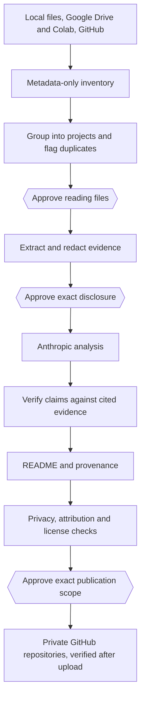

# PortfolioForge

**An LLM pipeline that finds old software projects across a computer, Google Drive, Colab and GitHub, works out what they do, documents them, and publishes them to private GitHub repositories, with every claim tied to evidence and every external action behind an approval.**

## The problem

Turning scattered, undocumented projects into repositories is an obvious job for an LLM, and a risky one: it can leak credentials and personal data, invent results, and present other people's code as yours. PortfolioForge treats these as engineering problems: the model only sees approved, redacted evidence, its output is verified locally, and nothing is published until blocking checks and an explicit approval pass.

## Pipeline



Hexagons are your approvals. Everything between them is automated, and a project that can't continue safely is deferred while the rest carry on.

## Engineering highlights

**Python architecture.** About 16,000 lines of Python 3.11+, with a standard-library core and separate packages for each stage. All three sources produce the same inventory format, so later stages don't care where a project came from.

**Anthropic integration.** The approved payload is the complete Messages API request body. Each send checks its SHA-256 hash, provider and model against the approval, and a mismatch stops it. SDK retries are off and server-side fallbacks aren't enabled, so a different model can't process approved content. Each disclosure shows an upper-bound cost estimate before you approve it.

**Evidence-backed claim verification.** Model output is treated as untrusted. It must match a schema, each claim must cite evidence IDs, and local checks reject what the evidence doesn't support. Setup instructions are checked against the project's files, and each repository's `PROVENANCE.md` records which commands were actually run.

**Privacy controls.** Scans use metadata until you approve reading specific files. Sensitive file names and private folders are skipped, and excerpts are redacted before disclosure, with notebook outputs and data files left out. Likely secrets and personal identifiers block publication until reviewed.

**Resumable batch processing.** One queue and one review cover every project. State is worked out from saved approvals, proposals and stages, so an interrupted run resumes without repeating finished work. Saved AI answers are reused without a new request, and a send that ends unclearly is never retried automatically, since it may already have been charged.

**GitHub automation.** Publishing works from a staged copy and checks the commit against the approved bytes before upload. It never overwrites an existing repository, a batch only creates private ones, and visibility is confirmed afterward. GitHub discovery is read-only and never fetches file contents.

## Automated versus authorized

| Automated | Needs your authorization |
|---|---|
| Metadata scans, grouping, duplicate flags | Sign-ins and broad scans |
| Evidence extraction, redaction, disclosure preparation | Reading files, and each AI disclosure |
| Claim verification, READMEs, blocking checks | Repository names; ownership and license statements |
| Staging, resuming, deferring unsafe items | Publishing an exact private list; running project code |

Making a repository public is always your own separate decision.

## Quick start

Requires Python 3.11+, an `ANTHROPIC_API_KEY`, and the [GitHub CLI](https://cli.github.com/) signed in with `gh auth login`.

```powershell
git clone https://github.com/lindseyrich2/PortfolioForge.git
cd PortfolioForge
pip install -e ".[ai,dev]"

python -m portfolioforge.inventory "C:\path\to\projects"
python -m portfolioforge.batch run --provider anthropic
python -m portfolioforge.batch review
```

`review` lists every project and the exact command for each decision. The [usage guide](docs/USAGE.md) covers the approval commands, Drive and GitHub sources, and configuration.

## Results

The first full run, on the author's own projects, covered a local computer (599 files), Google Drive (277 items) and GitHub (16 repositories):

- **40 AI analyses** in the final batch, for at most $6.93, with every payload matching its approved hash and none retried
- **25 private repositories** published and verified on GitHub
- **75 candidates deferred** rather than guessed at

**The main lesson was about quality, not safety.** Every repository passed its checks, but many were small scripts or near-duplicates, and a human review of the source reduced the 25 to a handful. PortfolioForge doesn't judge how substantial a project is, so that stays with you.

## Testing

About 870 tests use temporary folders and invented data, and CI runs them with a privacy check on each pull request. v1.0.0 also passed an end-to-end acceptance test from a clean install, driving the real CLI against a fake GitHub CLI and a fake Anthropic server, with Drive using a simulated Google. The one failure was a poor error message for a missing API key.

## Main limitations

- There's no quality gate, and duplicate detection compares names, paths and sizes, not contents.
- GitHub projects are discovery only: to analyze one, clone it and scan it locally.
- Downloading Drive file contents has only been tested against a simulated Google.

See the [full list](docs/USAGE.md#limitations).

## Development and license

Built with [Claude Code](https://claude.com/claude-code) as the primary coding tool, under the author's direction. MIT licensed; see [`LICENSE`](LICENSE).
